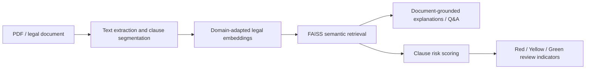

# LegalSimpl — Legal Document AI

An academic capstone exploring clause-level retrieval, plain-language explanations and risk flagging for complex legal documents. The aim is to help non-lawyers and other stakeholders identify obligations and potential liabilities in contracts, policies and notices.

**Repository status:** documentation release. The original application source and model artifacts are not yet included; there is no runnable app in this repository at this stage.

## Approach

The project report describes OCR/text cleaning, clause segmentation, CUAD-based adaptation of InLegalBERT, FAISS retrieval and RAG. It also explores threshold optimization through coarse-to-fine search and evolutionary refinement. The report includes proposed or developing components as well as preliminary experiments; its descriptions should not all be interpreted as validated final functionality.

## Available material

- [Research report](docs/LegalSimpl_research_report.pdf): architecture, methods, preliminary evaluation and limitations.
- [Evaluation notes](docs/EVALUATION_NOTES.md): what the reported numbers do and do not establish.

## Evaluation status

The research report describes preliminary experiments. A later review of the original exported notebook establishes that the risk classifier's **macro-F1 0.8113 and accuracy 0.91 were measured on 1,000 synthetic, weak-labelled evaluation clauses**, drawn from 10,000 generated clauses (9,000 train / 1,000 evaluation). These are not expert-annotated real-contract results.

The report's “Precision@5 0.80” is not standard precision: the inspected notebook code sets the value to 1 when any retrieved item matches a keyword pattern. MRR@5 0.67 and other retrieval figures remain small prototype diagnostics. See [supplemental notebook findings](docs/SUPPLEMENTAL_NOTEBOOK_FINDINGS.md) for corrected interpretation.
No final Recall@k, independently validated legal-risk assessment, publication acceptance or production deployment is claimed. Plain-language output and risk flags assist review; they do not replace professional legal advice.

## Contributors

Student project team: Darshan Jethva, Swara Joshi and Teerth Chauhan, NMIMS MPSTME. Faculty contributors are credited in the report. Repository preparation preserves the distinction between team work and individual contributions.

## Reproducibility and next additions

The application code, environment specification, model/checkpoint references, dataset split and evaluation artifacts will be added when the original source is available. No implementation has been invented to fill this gap. Do not install or execute anything based on this documentation-only release.
